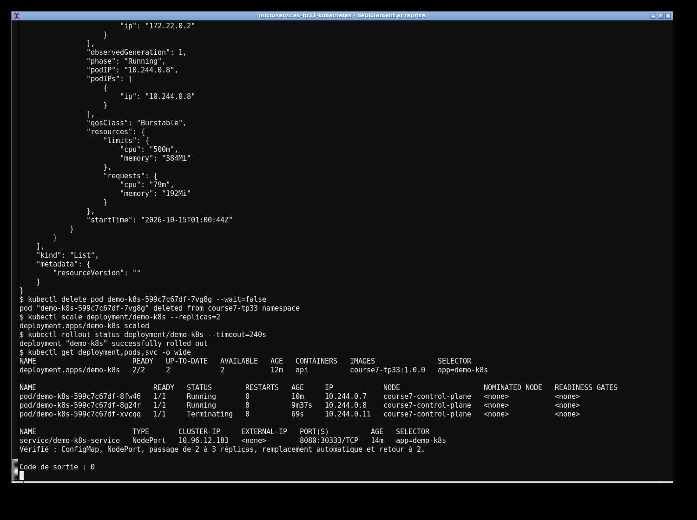

# TP33 — Spring Boot sur Kubernetes

 J'ai déployé une API Spring Boot dans un namespace séparé, avec deux replicas. Le message vient d'une ConfigMap. Le Service NodePort expose l'API et les sondes Actuator contrôlent si chaque pod est vivant et prêt. Les limites de ressources évitent de laisser les conteneurs sans limite.

 ```sh
 mvn clean verify
 docker build -t course7-tp33:1.0.0 .
 minikube image load course7-tp33:1.0.0
 kubectl apply -f k8s/
 kubectl rollout status deployment/demo-k8s -n course7-tp33
 kubectl get pods,svc -n course7-tp33
 ```

 L'API répond sur `http://$(minikube ip):30333/api/hello`. Pour reproduire les captures avec kind :

 ```sh
 kind create cluster --name course7 --config kind-config.yaml
 kind load docker-image course7-tp33:1.0.0 --name course7
 kubectl apply -f k8s/
 curl http://localhost:30333/api/hello
 ```

 Pour retirer uniquement ce lab : `kubectl delete namespace course7-tp33`.

 Les traces d'exécution sont dans `evidence/` et les captures dans `screenshots/`.

 
